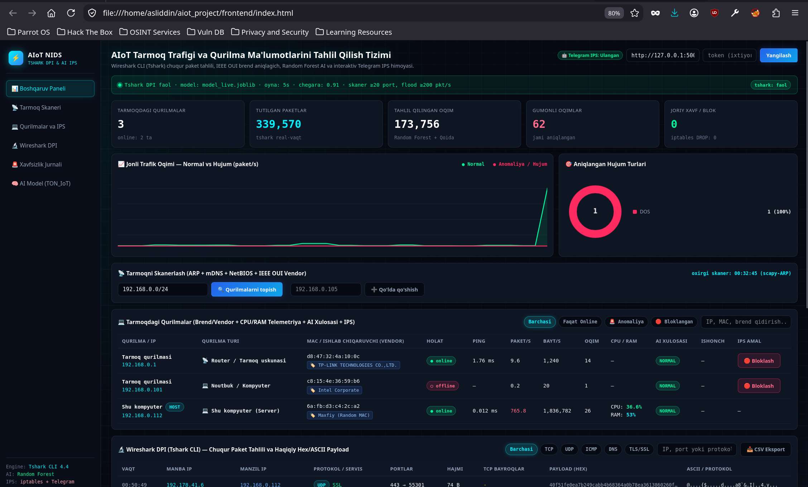
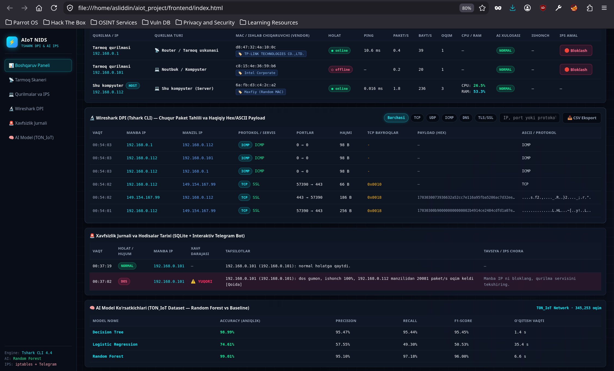
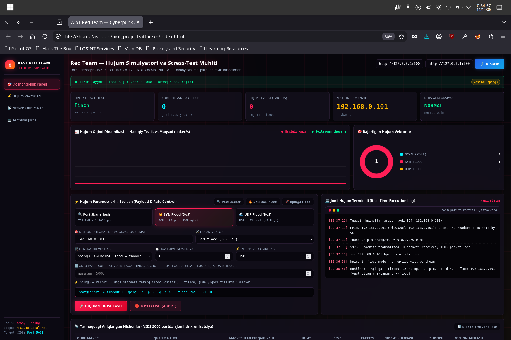
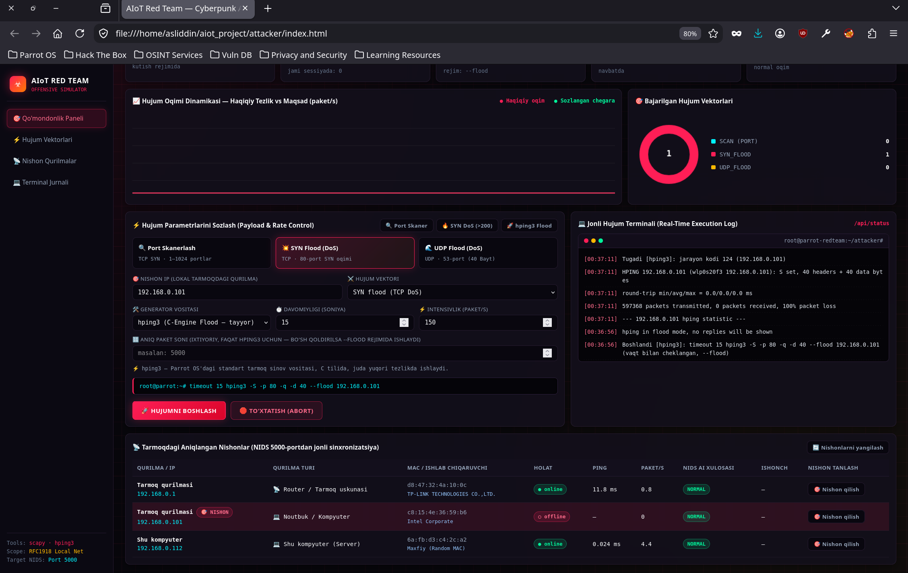
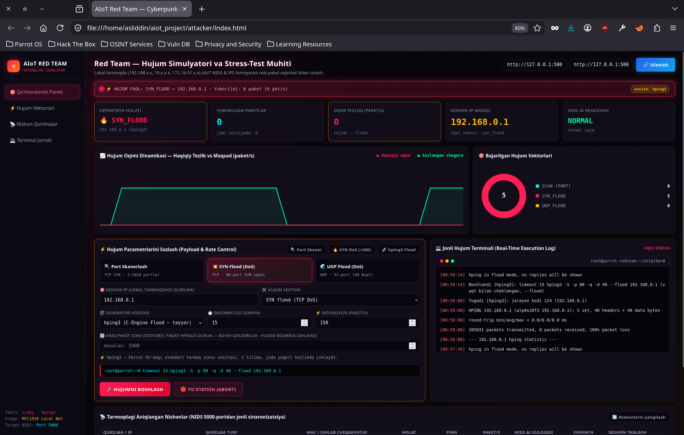
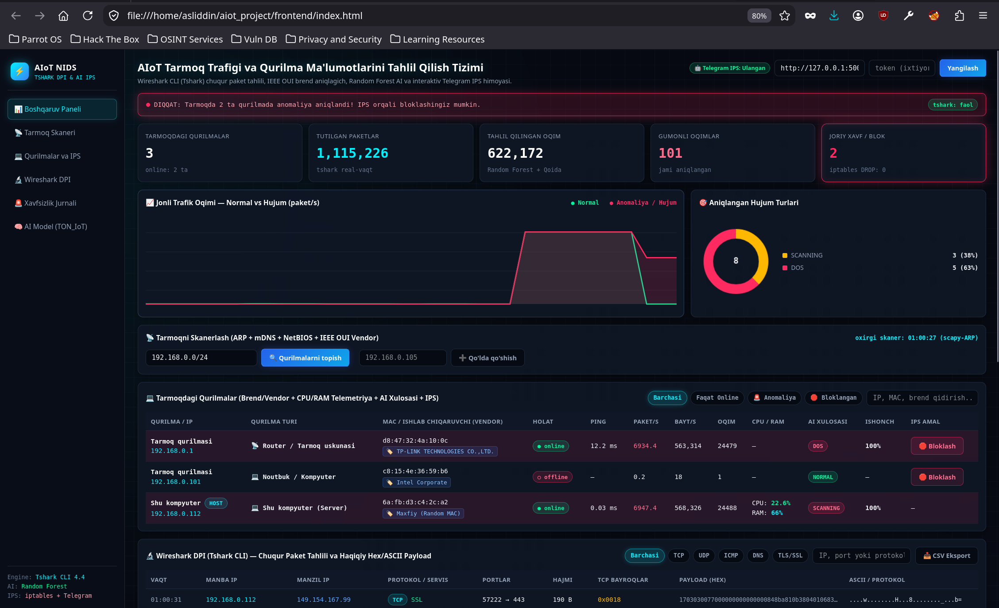
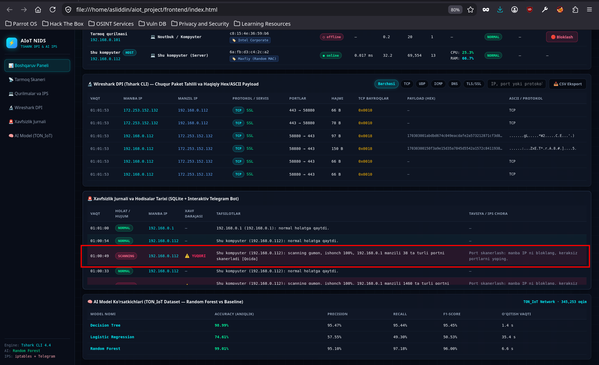
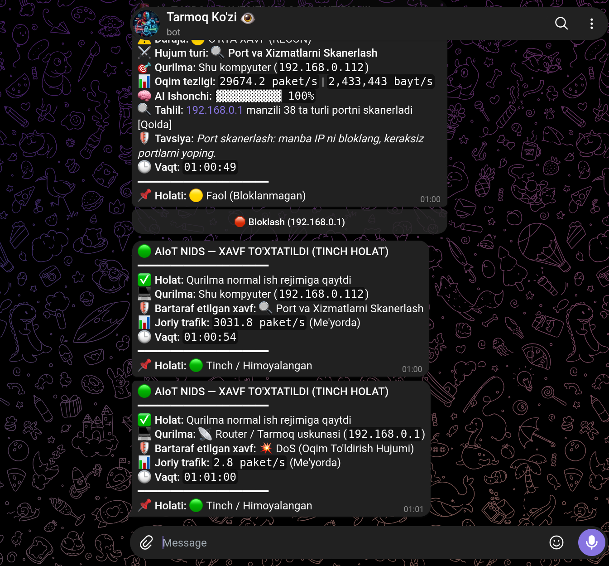

# 🛡️ AIoT NIDS & IPS (The Full Edition) — Sun’iy Intellekt va Tshark DPI Asosidagi Tarmoq Xavfsizligi hamda Monitoring Tizimi

> **Mavzu:** *IoT tizimlarida sun’iy intellekt yordamida tarmoq trafigi va qurilma ma’lumotlarini tahlil qilish.*

Ushbu dasturiy majmua lokal va **AIoT (Artificial Intelligence of Things)** tarmoqlaridagi qurilmalarni avtomatik aniqlash, **Wireshark CLI (`tshark`)** yordamida paketlarni chuqur tahlil qilish (**Deep Packet Inspection — DPI**), **TON_IoT** datasetida o'qitilgan **Random Forest** va **Isolation Forest (Zero-Day)** sun'iy intellekt modellari hamda evristik qoidalar sintezi orqali tarmoq hujumlarini (`DoS`, `DDoS`, `SYN Flood`, `UDP Flood`, `Port Scanning`, `Zero-Day Anomaly`) real vaqt rejimida tutish hamda **Linux xavfsiz `iptables` (AIOT_IPS Chain)** va interaktiv **"Tarmoq Ko'zi" Telegram SOC boti** orqali xavflarni bir tugma bilan bloklash (**IPS**) uchun to'liq ishlab chiqilgan kengaytirilgan tizimdir.

---

## ✨ Tizimning Asosiy Imkoniyatlari va Yangiliklari (The Full Edition)

* **🔬 Chuqur Paket Tahlili (Wireshark CLI / Tshark 4.4):** Har bir tarmoq paketining TCP bayroqlari, portlari, protokol xizmatlari hamda haqiqiy **Hex/ASCII Payload** ma'lumotlarini real vaqtda ushlaydi va tahlil qiladi (MQTT, CoAP, RTSP, SSDP, Modbus, DNS, HTTP va boshqalar).
* **🧠 Kengaytirilgan Sun'iy Intellekt (Gibrid RF + Isolation Forest):** 
  * `345,253` ta oqim asosida o'qitilgan **Random Forest** modeli (`99.01%` aniqlik);
  * Ilgari ko'rilmagan va yashirin anomaliyalarni tutuvchi **Isolation Forest (Zero-Day Anomaly Detector)** modeli;
  * Trafik portlashlarini soniyada tutuvchi evristik qoidalar filtri.
* **⚡ Server-Sent Events (SSE) Real-Time Oqim:** Brauzer tomonidan og'ir 2 soniyalik polling so'rovlari o'rniga zamonaviy SSE oqimi (`/api/stream`) orqali paketlar va signallarni lahzada (instant) ekranga chiqarish.
* **🛡️ Xavfsiz Maxsus IPS Zanjiri (`AIOT_IPS`):** Serverdagi mavjud tizim qoidalariga (`INPUT`) tegilmaydi. Barcha DROP cheklovlari faqat izolyatsiyalangan maxsus `AIOT_IPS` zanjirida bajariladi.
* **📋 Tarmoq Xavfsizlik Auditi Hisoboti (Export Report):** Tarmoqdagi jami qurilmalar, anomaliyalar statistikasi va bloklangan IP manzillarni bir tugma bilan interaktiv HTML/JSON hisobot ko'rinishida olish (`/api/report?format=html`).
* **📡 Qurilmalarni Aniqlash va Telemetriya:** ARP, mDNS, NetBIOS va **IEEE OUI Vendor** bazasi yordamida tarmoqdagi har bir qurilmaning IP, MAC manzili, ishlab chiqaruvchi brendi (masalan, *TP-Link*, *Intel*, *Espressif*), ping vaqti, paket/bayt tezligi hamda serverning **CPU/RAM** yuklamasini jonli ko'rsatadi.
* **🔥 Faol IPS va "Tarmoq Ko'zi" Telegram Boti:** Hujum aniqlanganda veb-interfeys yoki Telegram bot orqali birgina inline tugma bilan tajovuzkor IP manzilni bloklash va tiklash imkoniyati.
* **🐳 Docker va Docker Compose:** Barcha bog'liqliklarni o'rnatmasdan, bitta `docker compose up -d` buyrug'i orqali tizimni to'liq konteynerda ishga tushirish.
* **⚔️ Red Team — Hujum Simulyatori:** `Python Scapy (L3 Raw)` va `hping3 (C-Engine Flood)` dvigatellari asosida lokal tarmoqda *Port Skanerlash*, *TCP SYN Flood* va *UDP Flood* hujumlarini simulyatsiya qilish muhiti.

---

## 📸 Tizim Interfeysi va Ishlash Jarayoni (Skrinshotlar)

### 1. Boshqaruv Paneli va Tarmoq Skaneri (Tinch holat)
Tizim ishga tushganda `tshark` real vaqtda paketlarni ushlaydi. Grafikda normal trafik yashil chiziqda tasvirlangan, pastki qismda esa tarmoqdagi barcha aktiv qurilmalar va ularning MAC/Vendor ma'lumotlari aks etgan:


### 2. Wireshark DPI va AI Model Ko'rsatkichlari (TON_IoT)
Har bir paketning manba/manzil IP manzillari, TCP bayroqlari, protokollari va **TON_IoT** datasetida sinovdan o'tgan AI modellarning (*Decision Tree*, *Logistic Regression*, *Random Forest — 99.01%*) aniqlik va F1-Score natijalari:


### 3. Red Team — Hujum Simulyatori va Stress-Test Muhiti
Kiberxavfsizlik tizimini sinash uchun ishlab chiqilgan **AIoT RED TEAM** paneli. Bu yerda hujum vektori, generator vositasi (`Scapy` yoki `hping3`), davomiylik va intensivlik sozlanadi:


### 4. Red Team — Tarmoqdagi Nishonlarni Avtomatik Aniqlash
Red Team paneli NIDSning `5000`-porti bilan jonli sinxronlashib, tarmoqdagi barcha qurilmalarni avtomatik ro'yxatga oladi va nishonga olish imkonini beradi:


### 5. Red Team — Faol TCP SYN Flood (DoS) Hujumi
`hping3 --flood` rejimi orqali yuqori tezlikdagi **SYN Flood (DoS)** hujumi boshlangan holat va jonli terminal loglari:


### 6. NIDS Reaksiyasi — Hujumni Aniqlash va Trevoga!
Hujum boshlanishi bilan NIDS paneli darhol qizil trevoga holatiga o'tadi va AI modeli **DoS** hujumi ekanligini aniqlaydi:


### 7. Haqiqiy Hex/ASCII Payload va Xavfsizlik Jurnali (SQLite)
Shifrlangan va ochiq paketlarning haqiqiy **Hex/ASCII** ichki payload ma'lumotlari hamda SQLite bazasiga yozilgan **Xavfsizlik Jurnali** tarixi:


### 8. "Tarmoq Ko'zi" — Interaktiv Telegram IPS Boti
Tarmoqda xavf aniqlanganda va bartaraf etilganda administratorga real vaqtda keluvchi bildirishnomalar hamda tezkor **🔴 Bloklash** inline tugmasi:


---

## 🛠️ Tizim Talablari va O'rnatish

Loyihani **Parrot OS**, **Kali Linux** yoki **Ubuntu/Debian** muhitida ishga tushirish:

### 1-Qadam: Tizim paketlarini o'rnatish
```bash
sudo apt update
sudo apt install -y tshark hping3 iptables python3-venv python3-pip
```

### 2-Qadam: Virtual muhit (`venv`) va kutubxonalar
```bash
cd ~/aiot_project_thefull/backend
python3 -m venv venv
source venv/bin/activate
pip install --upgrade pip
pip install -r requirements.txt
```

### 3-Qadam: Muhit o'zgaruvchilari faylini (`.env`) sozlash
Fayldan nusxa oling va bot tokeningizni kiriting:
```bash
cd ~/aiot_project_thefull
cp .env.example .env
nano .env
```
`.env` fayli ichiga o'zingizning Telegram BotFather tokeningiz va Chat ID raqamingizni yozing:
```env
TELEGRAM_BOT_TOKEN=bot_tokeningiz_shu_yerga
TELEGRAM_CHAT_ID=chat_id_raqamingiz
```

### 4-Qadam: AI Modellarini o'qitish (Random Forest + Isolation Forest)
```bash
cd ~/aiot_project_thefull/backend
source venv/bin/activate
python train_real.py
```

---

## 🚀 Ishga Tushirish Buyruqlari (Quick Start)

### 1. Asosiy NIDS & IPS Backend Serverini Yoqish (`Port 5000`)
```bash
cd ~/aiot_project_thefull/backend
source venv/bin/activate
sudo venv/bin/python app.py
```

### 2. Red Team Hujum Simulyatori Serverini Yoqish (`Port 5001`)
Alohida terminalda:
```bash
cd ~/aiot_project_thefull/attacker
source ../backend/venv/bin/activate
sudo ../backend/venv/bin/python app.py
```

### 3. Veb-Boshqaruv Panellarini Brauzerda Ochish
* **🛡️ AIoT NIDS Boshqaruv Paneli:** `file:///home/asliddin/aiot_project_thefull/frontend/index.html`
* **⚔️ Red Team Hujum Paneli:** `file:///home/asliddin/aiot_project_thefull/attacker/index.html`
* **📋 Tarmoq Xavfsizlik Auditi Hisoboti:** `http://127.0.0.1:5000/api/report?format=html`

---

## 🐳 Docker Orqali Ishga Tushirish (Alternative)

Agar dastur va uning barcha paketlarini Docker orqali ishga tushirmoqchi bo'lsangiz:
```bash
cd ~/aiot_project_thefull
docker compose up -d --build
```
Loglarni kuzatish:
```bash
docker compose logs -f
```

---

## 👨‍💻 Muallif
* **Ism-sharif:** Jumayev Asliddin Shahobbos o'g'li
* **Oliygoh:** Farg'ona davlat texnika universiteti (Kiberxavfsizlik yo'nalishi)
* **GitHub:** [@Asliddin-Jumayev](https://github.com/Asliddin-Jumayev)
