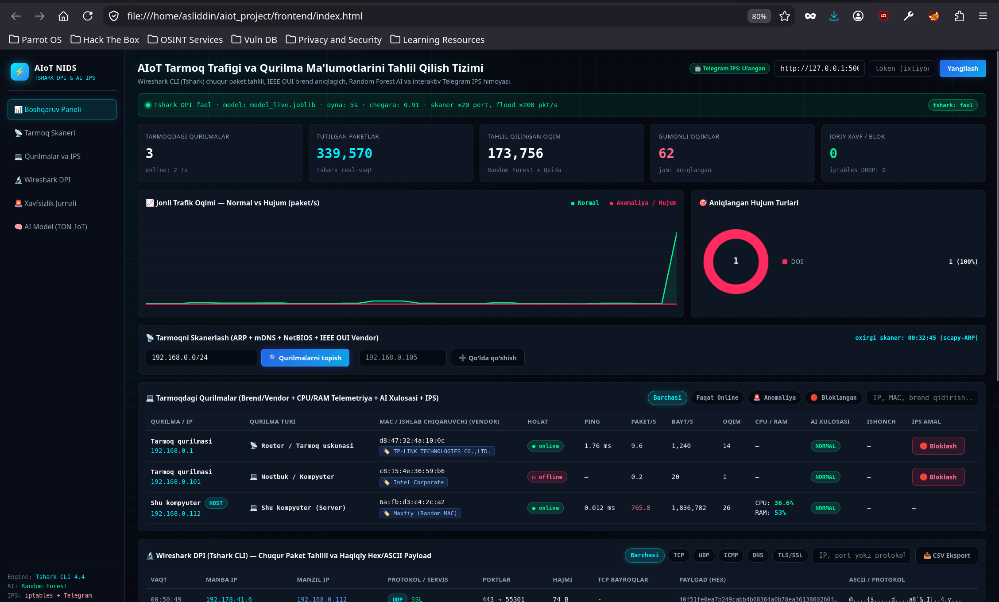
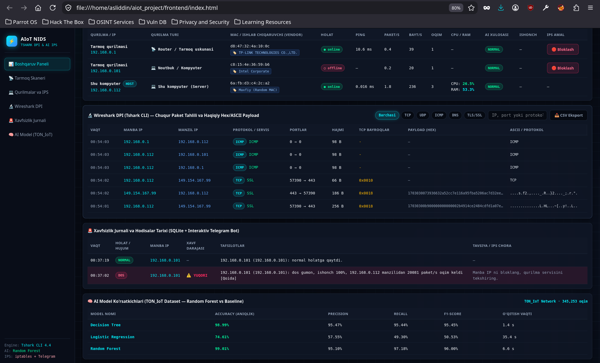
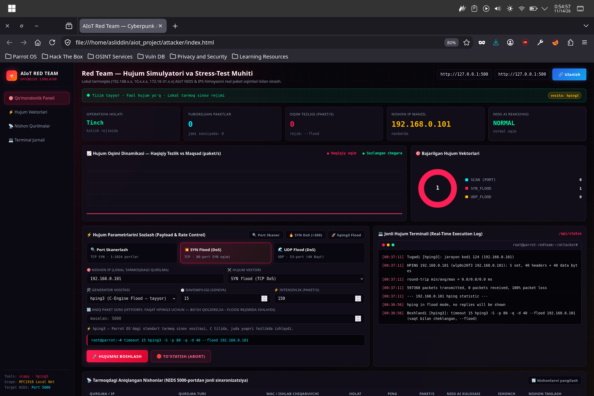
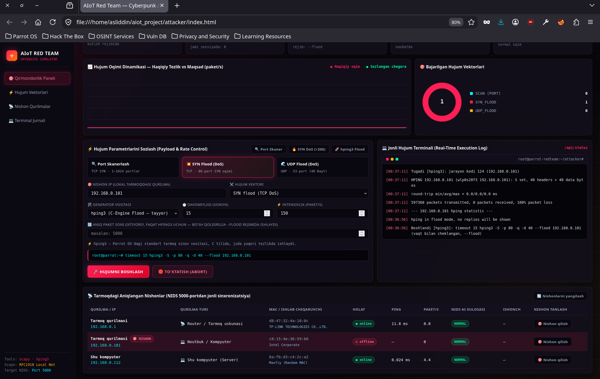
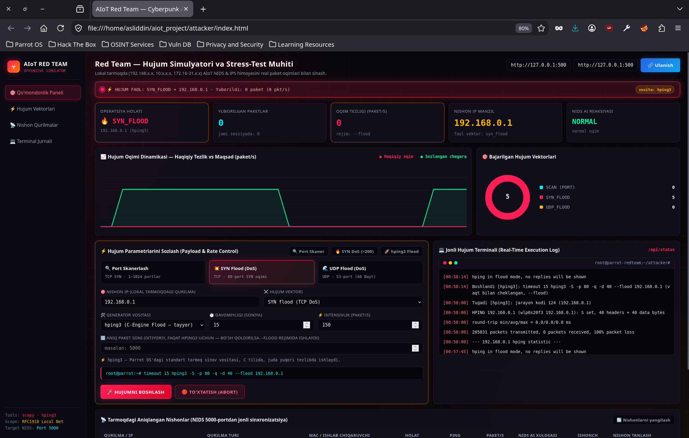
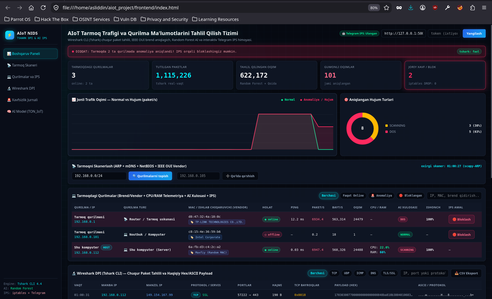
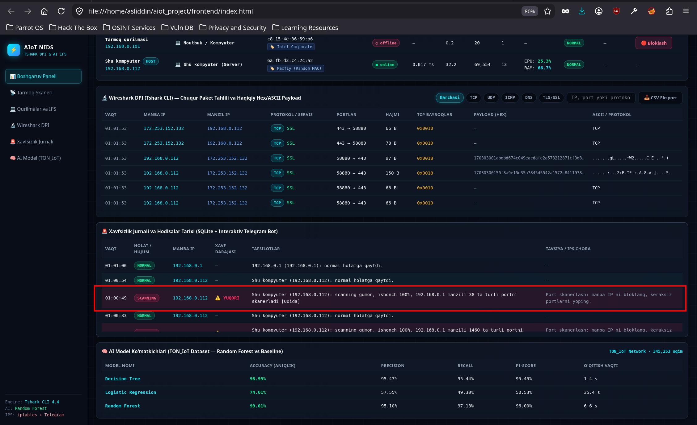
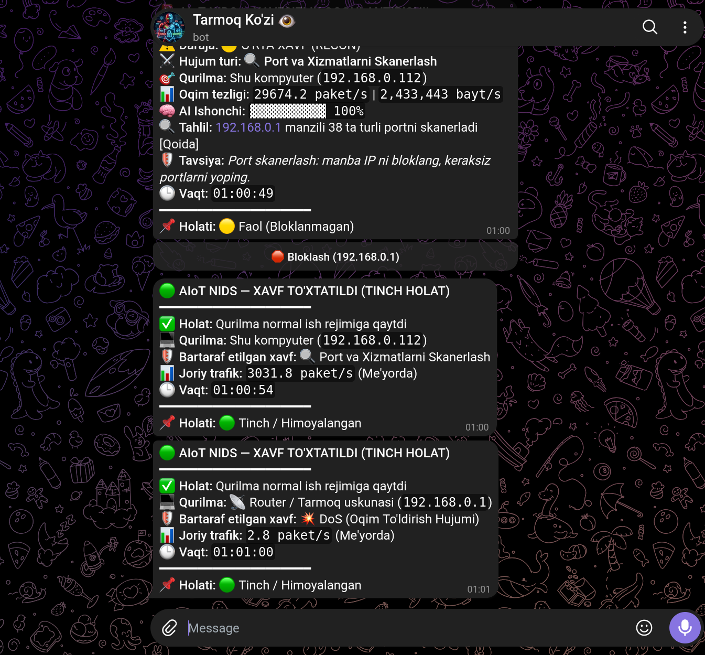

# 🛡️ AIoT NIDS & IPS — Sun’iy Intellekt va Tshark DPI Asosidagi Tarmoq Xavfsizligi hamda Monitoring Tizimi

> **Mavzu:** *IoT tizimlarida sun’iy intellekt yordamida tarmoq trafigi va qurilma ma’lumotlarini tahlil qilish.*

Ushbu dasturiy majmua lokal va **AIoT (Artificial Intelligence of Things)** tarmoqlaridagi qurilmalarni avtomatik aniqlash, **Wireshark CLI (`tshark`)** yordamida paketlarni chuqur tahlil qilish (**Deep Packet Inspection**), **TON_IoT** datasetida o'qitilgan **Random Forest** sun'iy intellekt modeli va evristik qoidalar sintezi orqali tarmoq hujumlarini (`DoS`, `DDoS`, `SYN Flood`, `UDP Flood`, `Port Scanning`) real vaqt rejimida tutish hamda **Linux `iptables`** va interaktiv **"Tarmoq Ko'zi" Telegram SOC boti** orqali xavflarni bir tugma bilan bloklash (**IPS**) uchun mo'ljallangan.

---

## ✨ Tizimning Asosiy Imkoniyatlari va Arxitekturasi

* **🔬 Chuqur Paket Tahlili (Wireshark CLI / Tshark 4.4):** Har bir tarmoq paketining TCP bayroqlari, portlari, protokol xizmatlari hamda haqiqiy **Hex/ASCII Payload** ma'lumotlarini real vaqtda ushlaydi va tahlil qiladi.
* **🧠 Sun'iy Intellekt (TON_IoT Dataset):** `345,253` ta tarmoq oqimi asosida o'qitilgan **Random Forest** modeli (`99.01%` aniqlik) va evristik qoidalar sintezi orqali *DoS/DDoS Flood*, *Port Scanning (Recon)* va anomal oqimlarni soniyalar ichida aniqlaydi.
* **📡 Qurilmalarni Aniqlash va Telemetriya:** ARP, mDNS, NetBIOS va **IEEE OUI Vendor** bazasi yordamida tarmoqdagi har bir qurilmaning IP, MAC manzili, ishlab chiqaruvchi brendi (masalan, *TP-Link*, *Intel Corporate*), ping vaqti, paket/bayt tezligi hamda serverning **CPU/RAM** yuklamasini jonli ko'rsatadi.
* **🔥 Faol IPS va "Tarmoq Ko'zi" Telegram Boti:** Hujum aniqlanganda veb-interfeys yoki Telegram bot orqali birgina tugma bilan tajovuzkor IP manzilni `iptables DROP` qoidasi orqali bloklash va xavf bartaraf etilgach, tiklash hisobotlarini olish imkoniyati.
* **⚔️ Red Team — Hujum Simulyatori:** `Python Scapy (L3 Raw)` va `hping3 (C-Engine Flood)` dvigatellari asosida lokal tarmoqda *Port Skanerlash*, *TCP SYN Flood* va *UDP Flood* hujumlarini simulyatsiya qilish va NIDS reaksiyasini jonli sinash muhiti.

---

## 📸 Tizim Interfeysi va Ishlash Jarayoni (Skrinshotlar)

### 1. Boshqaruv Paneli va Tarmoq Skaneri (Tinch holat)
Tizim ishga tushganda `tshark` real vaqtda paketlarni ushlaydi. Grafikda normal trafik yashil chiziqda tasvirlangan, pastki qismda esa tarmoqdagi barcha aktiv qurilmalar va ularning MAC/Vendor ma'lumotlari aks etgan:


### 2. Wireshark DPI va AI Model Ko'rsatkichlari (TON_IoT)
Har bir paketning manba/manzil IP manzillari, TCP bayroqlari, protokollari va **TON_IoT** datasetida sinovdan o'tgan 3 ta AI modelning (*Decision Tree*, *Logistic Regression*, *Random Forest — 99.01%*) aniqlik va F1-Score natijalari:


### 3. Red Team — Hujum Simulyatori va Stress-Test Muhiti
Kiberxavfsizlik tizimini sinash uchun ishlab chiqilgan **AIoT RED TEAM** paneli. Bu yerda hujum vektori, generator vositasi (`Scapy` yoki `hping3`), davomiylik va intensivlik sozlanadi:


### 4. Red Team — Tarmoqdagi Nishonlarni Avtomatik Aniqlash
Red Team paneli NIDSning `5000`-porti bilan jonli sinxronlashib, tarmoqdagi barcha qurilmalarni avtomatik ro'yxatga oladi va nishonga olish imkonini beradi:


### 5. Red Team — Faol TCP SYN Flood (DoS) Hujumi
`hping3 --flood` rejimi orqali yuqori tezlikdagi **SYN Flood (DoS)** hujumi boshlangan holat va jonli terminal loglari:


### 6. NIDS Reaksiyasi — Hujumni Aniqlash va Trevoga!
Hujum boshlanishi bilan NIDS paneli darhol qizil trevoga holatiga o'tadi va AI modeli **DoS** hujumi ekanligini aniqlaydi:


### 7. Haqiqiy Hex/ASCII Payload va Xavfsizlik Jurnali (SQLite)
Shifrlangan va ochiq paketlarning haqiqiy **Hex/ASCII** ichki payload ma'lumotlari hamda SQLite bazasiga yozilgan **Xavfsizlik Jurnali** tarixi:


### 8. "Tarmoq Ko'zi" — Interaktiv Telegram IPS Boti
Tarmoqda xavf aniqlanganda va bartaraf etilganda administratorga real vaqtda keluvchi bildirishnomalar hamda tezkor **🔴 Bloklash** inline tugmasi:


---

## 🛠️ Tizim Talablari va Paketlarni O'rnatish

Loyihani **Parrot OS** yoki **Kali Linux** muhitida noldan ishga tushirish uchun quyidagi qadamlarni bajaring:

### 1-Qadam: Tizim paketlarini o'rnatish (`tshark`, `hping3`, `iptables`)
```bash
sudo apt update
sudo apt install -y tshark hping3 iptables python3-venv python3-pip
```

### 2-Qadam: Virtual muhit (`venv`) yaratish va kutubxonalarni o'rnatish
```bash
cd ~/aiot_project/backend
python3 -m venv venv
source venv/bin/activate
pip install --upgrade pip
pip install flask flask-cors scapy scikit-learn pandas numpy joblib requests psutil
```

### 3-Qadam: AI Modelini o'qitish (Birinchi marta ishga tushirganda)
```bash
cd ~/aiot_project/backend
source venv/bin/activate
python train_real.py
```

---

## 🚀 Kundalik Ishga Tushirish Buyruqlari (Quick Start)

### 1. Asosiy NIDS & IPS Backend Serverini Yoqish (`Port 5000`)
Paketlarni `tshark` orqali ushlash va `iptables` bloklash funksiyalari ishlashi uchun serverni **`sudo`** huquqi bilan ishga tushiring:
```bash
cd ~/aiot_project/backend
source venv/bin/activate
sudo venv/bin/python app.py
```

### 2. Red Team Hujum Simulyatori Serverini Yoqish (`Port 5001`)
Yangi terminal oynasini oching va hujum simulyatorini ishga tushiring:
```bash
cd ~/aiot_project/attacker
source ../backend/venv/bin/activate
sudo ../backend/venv/bin/python app.py
```

### 3. Veb-Interfeyslarni Brauzerda Ochish
Firefox yoki boshqa brauzerda quyidagi fayllarni oching:
* **🛡️ AIoT NIDS Boshqaruv Paneli:** `file:///home/asliddin/aiot_project/frontend/index.html`
* **⚔️ Red Team Hujum Simulyatori Paneli:** `file:///home/asliddin/aiot_project/attacker/index.html`

---

## 🔐 Xavfsizlik Eslatmasi
GitHub'ga yuklashda shaxsiy bot tokeni va chat ID ma'lumotlari sizib chiqmasligi uchun ularni himoyalangan muhit o'zgaruvchilari orqali boshqarildi va ayanan shu malumotlar kiritiladigan qatrolar bo`sh qoldirildi, shu joylarga dastur ishga tushirilayotgan vaqtda hamma o'z tokenini va telegram id sini kiritadi, shunda dastur muammosiz ishlaydi.

## 👨‍💻 Muallif
* **Ism-sharif:** Jumayev Asliddin Shahobbos o'g'li
* **Oliygoh:** Farg'ona davlat texnika universiteti (Axborot xavfsizligi yo'nalishi)
* **GitHub:** [@Asliddin-Jumayev](https://github.com/Asliddin-Jumayev)

> **⚠️ Mas'uliyatni cheklash (Disclaimer):** Ushbu dasturiy majmua faqat ilmiy-tadqiqot, ta'lim va o'zingizga tegishli lokal tarmoq himoyasini sinovdan o'tkazish uchun mo'ljallangan.# IoT_AI_yordamida-tarmoqni-skanerlash
